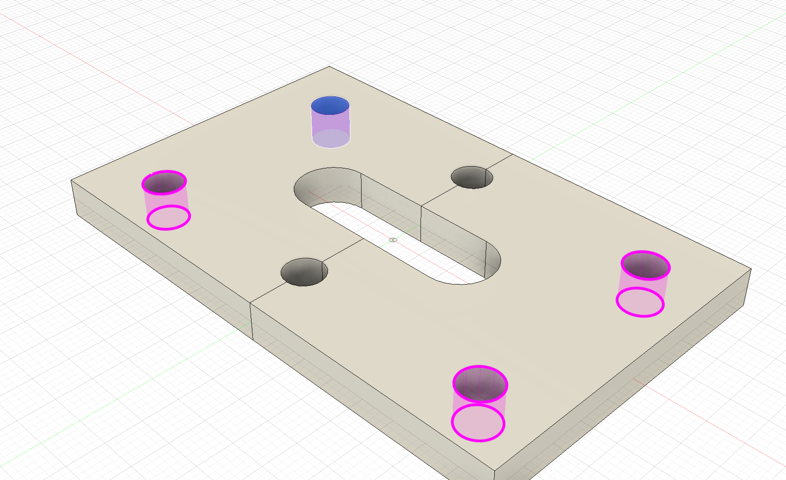
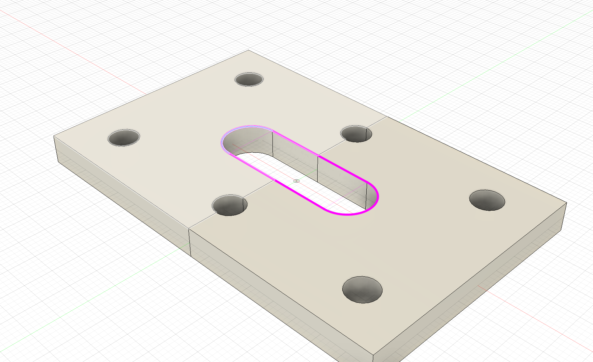

  

<h1 align="center">Selectra for Autodesk Fusion</h1>

<strong>Selectra — goddess of choice. Show an example. She’ll find the rest.</strong> Similar edges, matching faces, and closed contours — without picking every element by hand.

  
  

<a href="https://github.com/4FusionLab/Selectra/releases"><strong>Download</strong></a> · <a href="README.ru.md">Русский</a> · <a href="https://github.com/4FusionLab/Selectra/issues/new/choose">Report a problem</a>

## Pick the example. Keep the native selection.

Choose an edge or face, open the context menu, and let Selectra build your selection. Check the magenta highlight, adjust the range, and confirm. The result becomes ordinary Fusion selection, ready for your next modeling operation.

**Selectra 1.0.0 brings two commands: Select Similar and Select Chain.** [Release notes →](docs/releases/1.0.0.md)

| Command | What you can do |
| --- | --- |
| **Select Similar** | Find edges, faces, and face groups that match your examples |
| **Select Chain** | Follow a closed edge loop or a closed chain of wall faces |

## Select Similar

Start with one edge or face. Add **Examples** to explain what belongs in the selection, or use **Exclude** to point out an unwanted match.

- Shape and size take priority over position.
- Matches in the example planes come before parallel planes, then other planes.
- Separate planar examples can describe different shape and size families.
- Connected face examples can describe a repeating group, including curved groove walls.

Choose where to search with **Search Scope**:

| Scope | Where it searches |
| --- | --- |
| **This Body** | The source body in the selected instance |
| **This Component** | The selected component instance and its nested hierarchy; the default |
| **All Components** | The entire visible assembly |

## Select Chain

Pick an edge to select its closed loop, or a wall face to follow the surrounding closed wall chain.

**Chain across contact** continues a contour through complete, exact body contact, such as parts created by **Split Body**. It is enabled by default. Gaps, partial contact, and overlapping volumes do not create a connection. The original bodies remain separate.

## Two starting points

| Your task | Start here |
| --- | --- |
| Find matching edges or faces | Pick examples → **Select Similar** → refine the highlighted set |
| Follow a closed contour | Pick an edge or wall face → **Select Chain** → choose a contour |

**PgUp / =** adds the next level. **PgDown / -** removes the last included level. The slider controls the same range. Select Similar expands by similarity; Select Chain switches between complete contours through all examples. The mouse wheel stays available for Fusion navigation.

**OK** applies the highlighted set. **Cancel** restores your original selection. Model geometry and the timeline stay unchanged.

## See it in Fusion

Select Similar finds the four matching full cylindrical walls. Select Chain follows the slot across the exact split between two bodies. Blue marks the original example; magenta shows the proposed result.

[Wall-chain demo and release notes](docs/releases/1.0.0.md)

## Install

1. Download the add-in archive from [Releases](https://github.com/4FusionLab/Selectra/releases) and extract it to a permanent folder.
2. In Fusion, open **Utilities → Scripts and Add-Ins**.
3. Use **+ → Script or add-in from device** and select the `Selectra` folder containing `Selectra.py` and `Selectra.manifest`.
4. Select **Selectra → Run**. Pick an edge or face and open the context menu.

Fusion loads the add-in from that folder, so keep it in place. Selectra runs inside Autodesk Fusion on Windows and macOS; no separate Python installation or additional packages are needed.

[Installation, updates, and removal →](docs/INSTALLATION.md)

## Know the limits

Selectra works with BRep edges and faces. Sketch entities, mesh bodies, and T-Spline geometry are outside these commands. Imported geometry is supported when it is represented as BRep bodies.

Similarity depends on the available geometry. An identical radius alone does not identify an identical feature: an internal cylinder and an external shaft can share a radius. Check the preview before confirming, and use Examples or Exclude to refine the result.

## Documentation and support

[User guide](docs/GUIDE.md) · [FAQ](docs/FAQ.md) · [Release notes](docs/releases/1.0.0.md)

[Report a problem](https://github.com/4FusionLab/Selectra/issues/new/choose) · [Contributing](CONTRIBUTING.md) · [Security](SECURITY.md) · [Code of conduct](CODE_OF_CONDUCT.md)

## A little workshop mythology

Selectra is the goddess of choice, guardian of closed contours, and sworn enemy of picking the same faces by hand — from **4FusionLab's own mythology**, with a playful nod to ancient Greece. Her companion [Perfora](https://github.com/4FusionLab/Perfora), goddess of holes, takes care of the patterns.

[GPL-3.0-only](LICENSE). An independent **4FusionLab** project, not affiliated with or endorsed by Autodesk. Autodesk and Fusion are trademarks of Autodesk, Inc.
